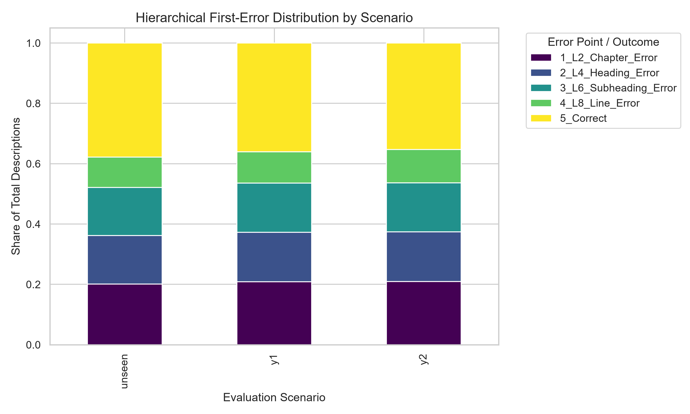
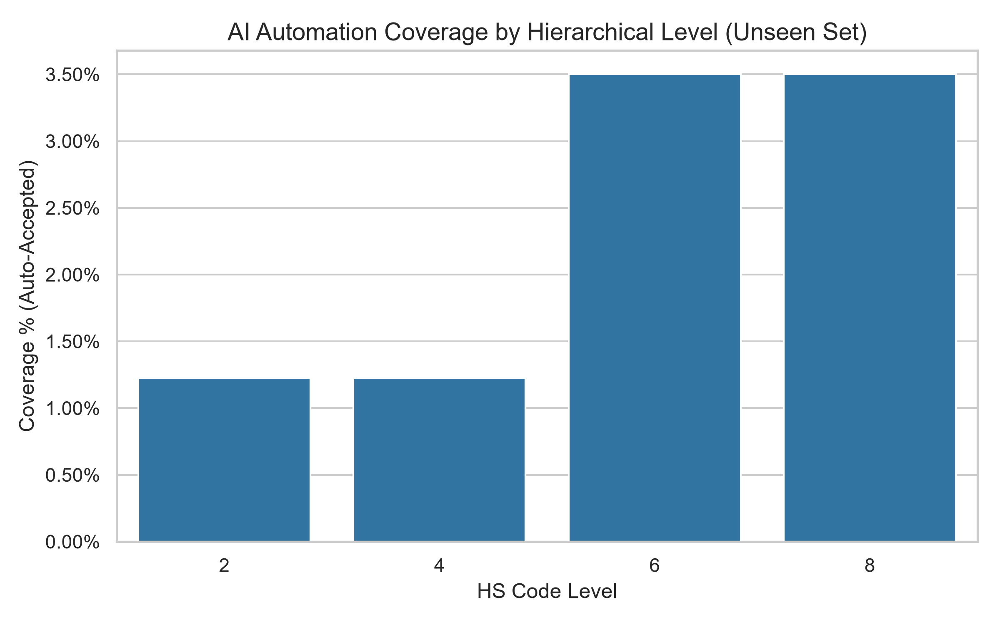
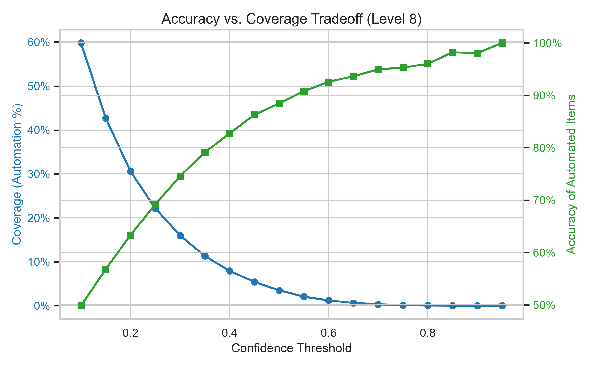
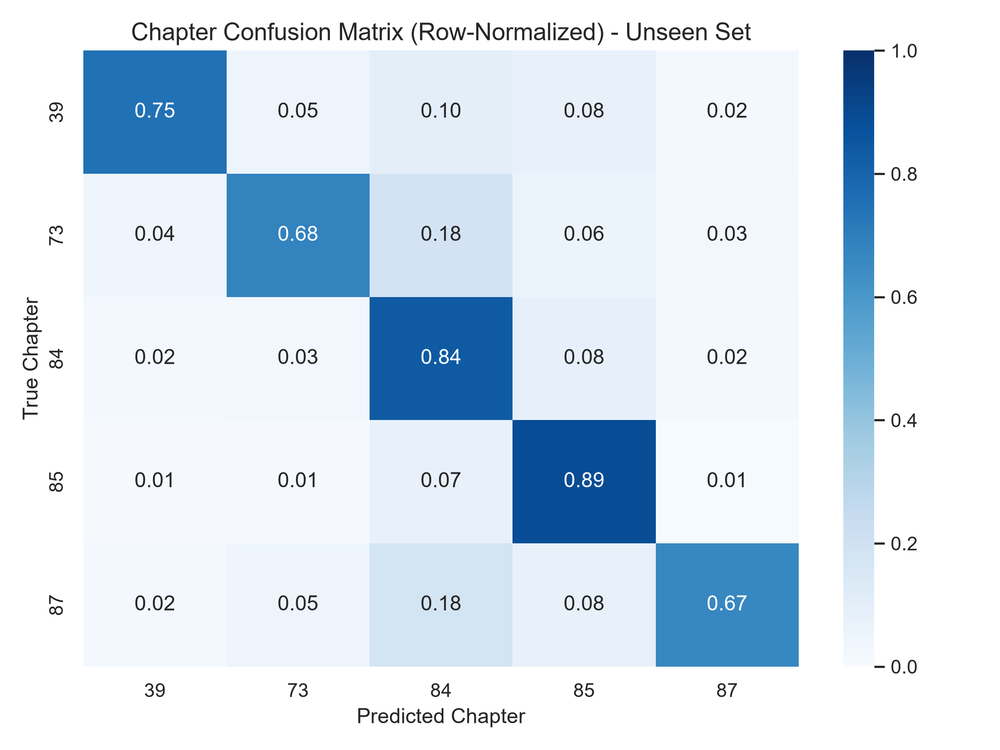

# Track C: HS Code Classifier Evaluation Report

## 1. Executive Summary
This report details the comprehensive evaluation of the hierarchical HS code classifier across 5 scoped chapters. The evaluation focuses on business-critical operational metrics: conceptual drift over time, automation workload routing, and hierarchical error forensics.

## 2. Headline Metrics (Unseen Baseline)
- **Accuracy (M1 / M2 / M3 at L8):** 38.8% / 32.8% / 33.1%
- **Top-5 Accuracy (L4 / L6 / L8):** 64.6% / 59.8% / 54.0%
- **Macro-F1 (L2 / L4 / L6 / L8):** 0.783 / 0.562 / 0.375 / 0.282
- **Cohen's Kappa (L2):** 0.733
- **Baseline Comparisons (L8):** Attainment Ratio: 0.415 | Lift vs Majority: 0.388
- **Temporal Drift (Y1/2024 M1 L8):** 36.6%

## 3. Reading Guide
- **Unseen:** A holdout test set drawn from the exact same timeframe as the training data (2023-2024).
- **Y1 (2024) & Y2 (2025):** Future temporal sets used to measure concept drift.
- **M1 / M2 / M3 Accuracy:** M1 weights by historical transaction volume; M2 weights by unique description strings; M3 evaluates macro-accuracy across classes regardless of class size.
- **Attainment Ratio:** The ratio of the model's accuracy (M1) divided by the theoretical upper bound (the model's performance if it perfectly guessed the majority label for every known description).
- **Lift vs. Majority:** The absolute percentage point improvement the AI provides over simply guessing the most frequent class globally.

## 4. Breakdowns & Concept Drift
The model demonstrates sensitivity to temporal drift and hierarchical complexity. Descriptions mapped to split subheadings perform significantly worse than single-line subheadings, isolating the model's primary weakness to 8-digit split disambiguation.

## 5. Confidence & Workload (Decision Support)
Applying frozen confidence thresholds reveals the operational reality of the model: it functions best as a high-precision human-in-the-loop support tool rather than a lights-out automation engine.
- At Level 8, applying a standard confidence threshold routes 96.50% of items to human review.
- However, the small subset of items (3.50%) that the AI auto-clears exhibit extremely high accuracy (88.45%), effectively skimming the easiest workload off the warehouse floor.
- The accuracy-coverage tradeoff curve below dictates the exact SLA operating points available to the business.

## 6. Error Forensics
When the AI fails, it often fails 'close' to the truth. Sibling error analysis reveals that 16.2% of Level 8 mistakes successfully landed within the correct Level 6 parent subheading.

## 7. Robustness (A9b Sensitivity)
A formal TF-IDF leakage probe demonstrated that ~10.9% of testing samples share a high textual similarity (>=0.95) with training records. This is an expected artifact of domain-specific nomenclature.

## 8. Caveats & Limitations
1. **Data Leakage Restraint:** Due to hardware constraints clustering 7.9 million rows, deep fuzzy-deduplication was skipped. The 10.9% A9b similarity overlap is formally acknowledged.
2. **Automation Ceilings:** Probability dilution across thousands of HS classes forces low confidence scores. A strict 0.50 threshold is highly conservative for this multi-class domain, driving the high human-routing volume.
